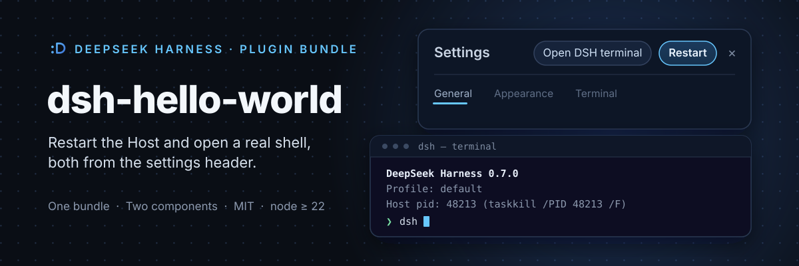
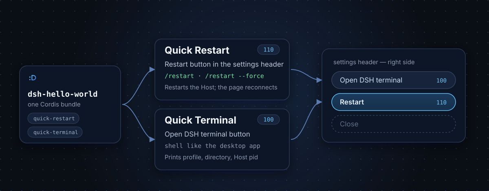

[English](./README.md) · **简体中文**

DeepSeek Harness 的一个小插件包，在设置页头部加入两个控件：**重启** 与 **打开 DSH 终端**。一个插件、两个组件——在插件管理页里可以各自独立开关。

## 你会得到什么

- **快速重启** —— 在头部其它动作旁加入「重启」按钮，并提供 `/restart` 命令。它会重启当前 Host，并让页面自动重连。
- **快速终端** —— 「打开 DSH 终端」按钮，打开一个与桌面应用完全一致的终端，欢迎横幅会打印 profile、目录和 Host pid。

## 两个组件如何组合

一个插件包同时包含两个组件。快速终端注册在 `100` 位，快速重启注册在 `110` 位，因此头部依次显示 **打开 DSH 终端**、**重启**，然后是关闭。



## 安装

把包加入某个 profile：

```bash
dsh plugin --profile <profile> add <本包目录>
```

然后打开 **设置**，两个按钮会出现在头部右上角。移除插件包：

```bash
dsh plugin --profile <profile> remove dsh-hello-world
```

## 使用

### 重启

- 点 **重启**。对话框会先说明将中断多少个任务，确认后才真正重启。
- 直接输入 `/restart` 会在 Host 有活动任务时拒绝执行；`/restart --force` 会忽略任务直接重启。
- 新 Host 启动后页面会自动重连；如果 25 秒内没有任何响应，则提供「刷新页面」作为兜底。
- 在命令行下 Host 就地重启；在桌面应用里则由应用重启自身。

### 终端

- 点 **打开 DSH 终端**。它会在部署目录用平台终端打开一个 shell，`dsh` 已在 `PATH` 中——与桌面应用使用的环境一致。
- 欢迎横幅会打印 profile、DSH home、工作目录和 Host pid（以及结束该进程的命令）。

## 配置项

重启组件从插件管理页的 `config` 块读取以下配置；终端组件没有配置项。

| 配置项 | 默认值 | 作用 |
| --- | --- | --- |
| `enabled` | `true` | 是否允许该部署重启自身。关闭后按钮仍然显示，并说明为何拒绝。 |
| `confirmBeforeRestart` | `true` | 重启前先确认。重启会中断正在运行的会话、排队消息和后台任务。 |
| `refuseWhileBusy` | `false` | 有 agent、排队消息或后台任务运行时拒绝重启。 |
| `allowSupervisor` | `false` | 允许在 systemd、launchd 或 pm2 下重启。进程监管可能杀掉或与新实例冲突。 |
| `delayMs` | `250` | 从应答请求到离开进程之间的毫秒数，用于让应答先到达页面。 |
| `waitTimeoutMs` | `30000` | 看门狗等待旧进程退出、端口释放的毫秒数，超时则强制处理。 |
| `settleTimeoutMs` | `30000` | 新实例绑定端口的最长毫秒数，超过即判定重启失败。 |

## 兼容性与限制

- Node.js ≥ 22.18，DeepSeek Harness `>=0.2.1-rc.2 <0.3.0`。
- 默认拒绝在进程监管（supervisor）下重启，因为监管进程可能杀掉或与新实例冲突。
- 基于 MIT License 开源。
